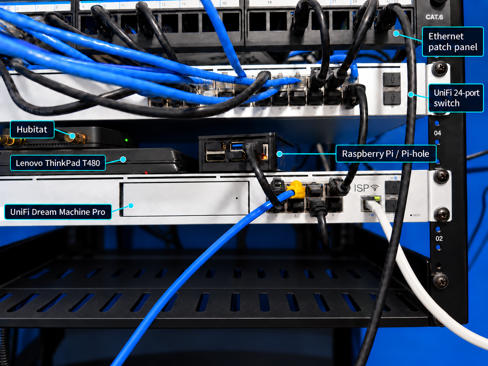
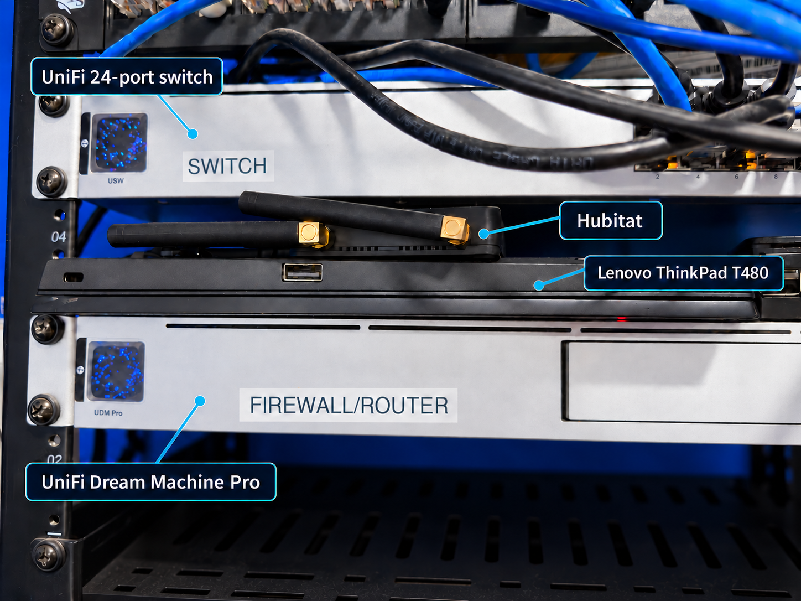
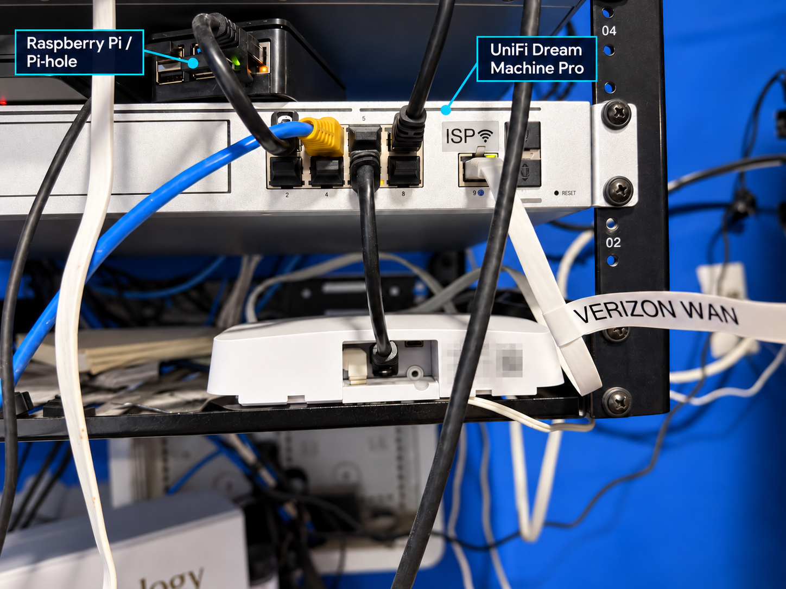
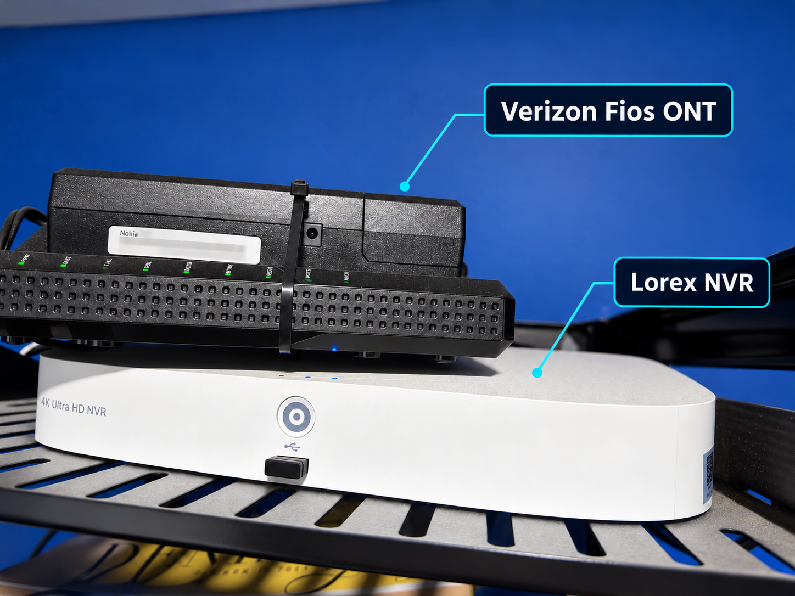

# CastleRock Homelab

**Robert Taylor · Networking, systems, and infrastructure security**

[Portfolio](https://lab.techresqsolutions.com) · [Hardware gallery](https://lab.techresqsolutions.com/homelab.html) · [GitHub profile](https://github.com/datphillyboi-spec)

CastleRock is my personal environment for building and operating networked services. I use it to practice routing and switching, network segmentation, DNS availability, Linux virtualization, container operations, monitoring, and recovery. This repository documents the physical equipment and connects it to the operational evidence in my portfolio.

## Why CastleRock?

The CastleRock name is inspired by Casterly Rock from *Game of Thrones*. As the lab grows, I plan to continue the Game of Thrones naming theme for future nodes.

## Physical lab

| Equipment | Role / identification |
| --- | --- |
| Verizon Fios ONT | ISP fiber handoff; black Nokia unit at the top of the rack |
| Lorex NVR | Camera recording; white unit immediately below the ONT |
| Ethernet patch panel | Structured cabling termination |
| UniFi 24-port switch | Wired network aggregation |
| UniFi Dream Machine Pro | Rack-mounted network gateway and firewall |
| Lenovo ThinkPad T480 | Laptop directly above the gateway |
| Hubitat | Automation hub resting on the T480 |
| Raspberry Pi / Pi-hole | DNS filtering appliance to the right of the laptop |

More labeled equipment photos

### Gateway, laptop, and automation hub

### Raspberry Pi and gateway detail

### ISP handoff and camera recording

## Documented projects

| Project | What the portfolio documents | Evidence |
| --- | --- | --- |
| Network infrastructure | UniFi routing, switching, wireless coverage, and trusted/IoT segmentation | [Network](https://lab.techresqsolutions.com/infrastructure-network.html) |
| DNS availability | Primary Raspberry Pi and backup Pi-hole with Keepalived/VRRP, a shared virtual endpoint, and DNS response checks | [Pi-hole failover](https://lab.techresqsolutions.com/project-dns.html) |
| Virtualization and containers | Proxmox VE, LXC, Docker services, storage dependencies, and maintenance | [CastleRock](https://lab.techresqsolutions.com/project-castlerock.html) |
| Monitoring | Main service monitoring plus a separate Raspberry Pi monitor for CastleRock availability | [Monitoring](https://lab.techresqsolutions.com/project-monitoring.html) |
| Home automation | Home Assistant integration and operational dashboards | [Automation](https://lab.techresqsolutions.com/project-automation.html) |
| Service maintenance | Documented application update and recovery procedures | [Maintenance](https://lab.techresqsolutions.com/project-maintenance.html) |

## Engineering focus

- Trace dependencies from the ISP handoff through switching, DNS, compute, and applications.
- Separate trusted clients and IoT devices and document necessary access between them.
- Check the DNS service itself instead of relying only on host reachability.
- Monitor critical hosts from another device so a host failure does not also silence its monitor.
- Document maintenance, failure symptoms, recovery steps, and remaining limitations.

## Planned hardware upgrade

I plan to replace the ThinkPad T480 with a tiny form factor desktop once I find an affordable used system. The T480 remains part of the current setup until that replacement is acquired.

## Next learning objectives

- Build repeatable VLAN and inter-VLAN access-policy test cases.
- Deepen routing and troubleshooting practice using packet captures and isolated lab scenarios.
- Record controlled DNS failover and recovery results, including detection and recovery timing.
- Expand infrastructure security monitoring and document resource requirements before deployment.

