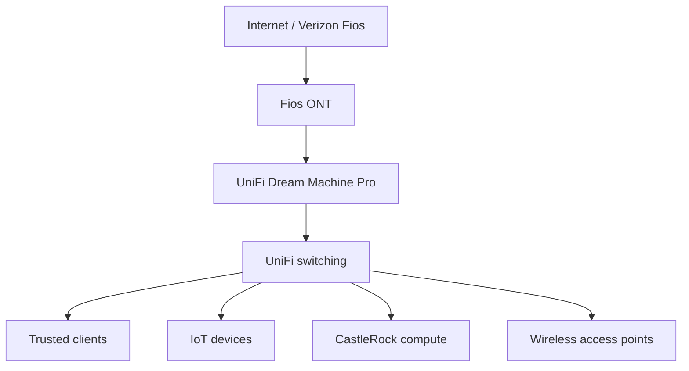

# Architecture and operating principles

High-level network architecture.

## DNS availability

The existing portfolio documents a primary Pi-hole on a Raspberry Pi and a backup instance, using Keepalived and VRRP for a shared DNS endpoint. DNS response health checks provide a more useful signal than ping alone. DHCP remains a gateway responsibility.

## Monitoring independence

The main Uptime Kuma instance monitors services. A separate Raspberry Pi instance monitors CastleRock availability. This reduces dependence on the host being monitored, but it does not remove shared dependencies such as household power, switching, or the internet connection.

## Evidence to add during future lab work

| Exercise | Record |
| --- | --- |
| VLAN isolation | Source and destination zones, intended policy, observed allow/deny result |
| DNS failover | Failure injected, DNS responses, detection time, failover time, recovery behavior |
| Service update | Version before/after, backup checkpoint, health check, rollback procedure |
| Outage monitoring | Detection time, notification receipt, recovery notification |

